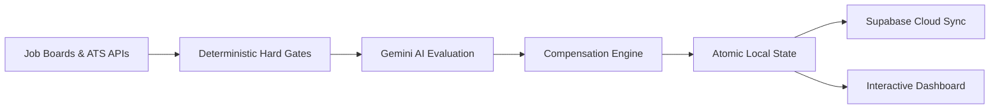

# Autonomous Job Discovery & Career Intelligence Platform

Production-grade career automation engine for specialized engineering disciplines (Energy, Natural Gas, Solar PV, BESS, SCADA, and UAVs). The system handles multi-source ingestion, deterministic statutory gating, calibrated Google Gemini AI evaluation, cross-device cloud synchronization, and responsive dashboard reporting.

---

## Architecture Overview



---

## Core Capabilities

- **Resilient Multi-Source Ingestion:** Automated collection across LinkedIn, regional job boards, and direct ATS APIs (Greenhouse, Lever, Comeet, Ashby) with circuit-breaker protection and exponential backoff.
- **Deterministic Hard Gates:** Pre-screens roles against geographic commute limits, statutory compensation floors, and target employer lists before AI invocation.
- **Calibrated Multi-Model AI Evaluation:** Evaluates candidate fit via structured Pydantic schemas in Google Gemini, returning objective scores (0-100), verified evidence matches, and gap analysis.
- **Evidence-Based Salary Intelligence:** Combines explicit listing data with industry compensation baselines across technical domains.
- **Secure Cloud Synchronization:** Non-destructive Compare-And-Swap (CAS) state synchronization over Supabase PostgreSQL with Row-Level Security (RLS) across desktop and mobile.
- **Single-Page Analytics Dashboard:** Client-side glassmorphism dashboard built with CSS Cascade Layers (`@layer base, dashboard`), high-contrast dark and light modes, and instant search.

---

## Quick Start

### 1. Installation
```bash
git clone https://github.com/idogal0210-web/job_search_automation.git
cd job_search_automation
python3 -m venv .venv && source .venv/bin/activate
pip install -r requirements-lock.txt
```

### 2. Configuration
Create a `.env` file in the project root:
```bash
GEMINI_API_KEY="your-gemini-api-key"
# Optional overrides:
GEMINI_MODELS="gemini-3.8-flash,gemini-3.5-flash-lite,gemini-3.5-flash"
SUPABASE_URL="https://your-project.supabase.co"
SUPABASE_KEY="your-publishable-key"
```

### 3. Execution
```bash
# Run full collection, evaluation, and dashboard generation pipeline
python3 main.py

# Recompile frontend assets to docs/ distribution
python3 src/ui_builder.py
```

---

## Quality Gate & Verification

```bash
# Run test suite
python3 -m unittest discover -s tests -p "test_*.py"

# Zero-emoji compliance audit
python3 scripts/validate_zero_emoji.py

# Hygiene, valid schemas, and secret detection
python3 scripts/project_hygiene.py --check-secrets --validate

# Verify 1:1 parity between frontend/ and docs/
python3 tests/test_template_docs_sync.py
```

---

## Key Invariants

- **Zero Emojis:** Strictly no pictorial emojis across code, tests, documentation, or commit messages.
- **Privacy First:** Zero personal identifiable information (PII) or hardcoded credentials.
- **Dual-Template Guard:** Edit strictly in `frontend/`, compile deterministically to `docs/`.
