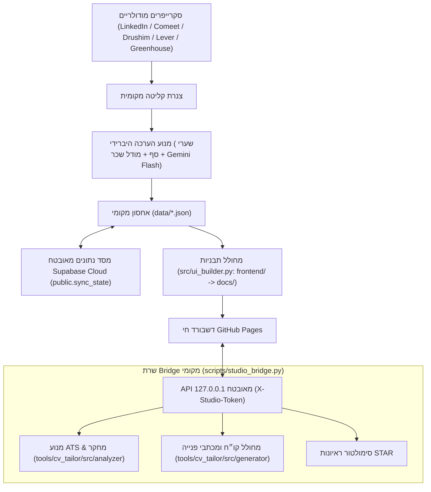

# PRD: פלטפורמה אוטונומית לאיתור משרות והתאמת קריירה (job_search_automation)

**מעמד: מסמך אפיון מובנה ומעוגן (שלד 37 הסעיפים התקני). מהווה את מקור האמת הבלעדי לכל דרישה, מודול ופיתוח קוד בפרויקט.**

הנחיות שימוש לפי פרוטוקול הבנייה מתוך האפיון (prd-build-protocol):
- כל שורת קוד, מודול, תיקון או תוצר טכני נגזרים אך ורק מדרישה ממוספרת (REQ-XX) המופיעה במסמך זה.
- חוק הברזל: כל שדה שאין לו מקור מאומת במסמכי הפרויקט נשאר [טרם נקבע]. אין להמציא נתונים סינתטיים.
- כל שינוי מהותי בארכיטקטורה, שילוב ספק או שינוי מודל מחייב מסמך החלטה ב-`docs/decisions/` לפני כתיבת קוד.
- איסור מוחלט על אימוג'ים (Zero Emojis Invariant) בכל רחבי המערכת והתיעוד.

---
## חלק א: בסיס ואסטרטגיה

### סעיף 1: כותרת המסמך ופרטי הפרויקט

**מטרה**: להחזיק את זהות המסמך ואת יומן השינויים שלו.

| השדה | הערך |
| :-- | :-- |
| שם הפרויקט | job_search_automation (פלטפורמת איתור משרות וסטודיו קריירה) |
| מוביל הפרויקט / מועמד | עידו גל (Ido Gal) - הנדסאי מכונות, אנרגיה / גז טבעי / סולארי / תשתיות תפעול / רחפנים |
| גרסת ה-PRD | 1.0.0 |
| תאריך עדכון אחרון | 2026-11-18 |
| מצב ההפעלה של המנגנון | מערכת אוטונומית בייצור: סריקות מתוזמנות, סנכרון ענן Supabase, שרת מקומי ודשבורד חי |

**יומן השינויים**:

| גרסה | תאריך | מה השתנה | המסמך הקולט |
| :-- | :-- | :-- | :-- |
| 0.1 | 2026-11-18 | הוקם שלד 37 הסעיפים מתבנית האב הגלובלית | docs/PRD.md |
| 1.0.0 | 2026-11-18 | עיגון מלא של נתוני הפרויקט מ-PROJECT_CONTEXT.md, TASKS.md והגדרת דרישות REQ-01 עד REQ-15 | docs/PRD.md |

### סעיף 2: תקציר מנהלים

**מטרה**: לתת לקורא חיצוני את מהות הפרויקט בפסקה אחת.

job_search_automation היא פלטפורמה אוטונומית ברמת ייצור (Production-Grade) לאיתור, סינון והתאמת משרות עבור עידו גל (הנדסאי מכונות מוסמך בעל ניסיון רב-תחומי במתקני גז טבעי, מערכות סולאריות/BESS, מערכות מכניות מורכבות, בקרת SCADA ורחפנים). הפלטפורמה כוללת: סריקה רב-ערוצית של עשרות חברות יעד ולוחות משרות, מנוע הערכה היברידי (שערי סף רגולטוריים, מודל שכר וציון Gemini Flash), סנכרון ענן אדיטיבי ומאובטח מול Supabase (טבלת `public.sync_state`), דשבורד כפול (Dual-Template `frontend/` -> `docs/`) הפרוס ב-GitHub Pages, וסביבת עבודה ארגונומית מתקדמת - סטודיו קריירה (Career Studio 3.0) להתאמת קורות חיים מדויקת מול מערכות ATS, שדרוג שורות מבוסס ראיות ועריכת WYSIWYG חיה, וסימולטור ראיונות מקצועי בשיטת STAR.

### סעיף 3: הגדרת הבעיה ושורש הבעיה

**מטרה**: לקבוע מהי הבעיה שהפרויקט בא לפתור, ומה שורשה.

- **תיאור הבעיה:** חיפוש משרות מקצועיות בתחומי ההנדסה והאנרגיה בישראל כרוך בהצפה של אלפי משרות כלליות, דרישות סותרות, תהליכי מיון מסורבלים במערכות ATS אוטומטיות הדוחות מועמדים איכותיים בגלל היעדר מילות מפתח מדויקות, ובזבוז שעות עבודה יומיות על סינון ידני ושכתוב מותאם של קורות חיים.
- **שורש הבעיה:** היעדר התאמה בין שפת דרישות המשרה הרשמית לבין הצגת הניסיון המעשי של המועמד, חוסר אחידות במבנה לוחות המשרות (LinkedIn, Drushim, Comeet, Greenhouse, Lever), והיעדר כלי אינטגרטיבי המגשר בין שלב האיתור, שלב ניתוח הפערים ושלב ההתאמה האישית בזמן אמת.
- **עדות למה שקורה היום:** סריקה ידנית יומית דורשת 2-3 שעות, כרוכה בסינון כפול של משרות שכבר נבחנו או נדחו, גורמת לעיוורון למשרות איכותיות בחברות מובילות, ומייצרת הגשות גנריות בעלות אחוז מענה נמוך.

### סעיף 4: אבחנת הערך, הצורך והרצון

**מטרה**: להבחין בין משתמשי הצורך למשתמשי הרצון, ולקבוע את הערך ואת הבזבוזים.

- **משתמשי הצורך (מועמד מחפש עבודה):** זקוקים לכלי איתור ממוקד שמסנן רעשים באופן דטרמיניסטי, מזהה התאמה טכנית אמיתית ללא הזיות, ושומר על ריאליזם מוחלט (100% עובדות, אפס המצאות, שימור שמות תפקידים מקוריים).
- **משתמשי הרצון (מעסיקים ומגייסים):** מעוניינים לקבל מסמך קורות חיים חד, ממוקד דרישות תפקיד, עם מדדים כמותיים ברורים ומענה ישיר לשערי הסף, ללא מלל מיותר.
- **הערך המרכזי:** קיצור זמני תגובה למשרות חדשות לפחות מ-24 שעות, העלאת ציון התאמת ATS מעל 80%, מניעת טעויות הגשה למעסיקים חסומים, ומוכנות מיידית לראיונות מקצועיים.
- **הבזבוזים שהמערכת מסירה:** ביטול סריקה ידנית כפולה, ביטול שכתוב ידני חוזר של קו״ח, מניעת הגשות עיוורות למשרות לא מתאימות (שכר נמוך, תחום לא הנדסי), ומחיקת רעשי רקע.

### סעיף 5: מיפוי התהליך הקיים מול הרצוי

**מטרה**: להציג את התהליך כפי שהוא היום ואת התהליך הרצוי, ואת הפער ביניהם.

- **התהליך הקיים:** גלישה ידנית במספר אתרים -> פתיחת עשרות טאבים -> קריאה ידנית של דרישות -> בדיקה ידנית אם המשרה רלוונטית -> כתיבת קו״ח מותאמים בקובץ Word מקומי -> שליחה בדוא״ל או בפורטל.
- **התהליך הרצוי:** סריקה אוטונומית יומית ברקע -> סינון אוטומטי מבוסס שערי סף וציון AI -> הצגה מרוכזת בדשבורד אינטראקטיבי -> כניסה בלחיצה אחת לסטודיו קריירה (Career Studio) -> ניתוח פערי מילות מפתח -> שדרוג שורות ועריכת WYSIWYG חיה ב-A4 -> יצוא ישיר של PDF/HTML מוכן להגשה.
- **הפער:** אוטומציה מלאה של שלב האיסוף והניתוח, ומתן סביבת עבודה חצי-אוטונומית מהירה ומדויקת לשלב ההתאמה וההגשה.

### סעיף 6: מחקר שוק, פער ההזדמנות, וההכרעה לפתח או לרכוש

**מטרה**: לקבוע אם קיים פתרון בשוק, ומה נובע מכך.

- **פתרונות קיימים בשוק:** כלים מסחריים גלובליים (Jobscan, Teal, Resume Worded, Rezi).
- **פער ההזדמנות:** אף כלי מסחרי אינו מותאם לשוק העבודה הישראלי, אינו תומך בעברית מימין לשמאל (RTL) ברמת ייצור, אינו מסנכרן ישירות מול לוחות ישראליים (דרושים, Comeet מקומי), אינו מחזיק שערי סף לתקני גז טבעי/חשמל/רחפנים ישראליים, ודורש תשלום מנוי חודשי יקר.
- **סוג הפתרון:** פיתוח מלא בהתאמה אישית (Full Custom Multi-Tier Platform).
- **ההכרעה לפתח ונימוקה:** פיתוח מערכת ייעודית מקומית המבוססת על מודלים מתקדמים (Gemini Flash), שרת מקומי מאובטח, אחסון ענן Supabase ודשבורד GitHub Pages ללא עלויות רישוי חודשיות שוטפות ועם ריבונות מלאה על המידע.

### סעיף 7: משתמשים ובעלי עניין

**מטרה**: למפות מי נוגע במערכת, בכמה עוצמה ובכמה עניין.

- **משתמש ראשי (עוצמה גבוהה, עניין מקסימלי):** עידו גל (הנדסאי מכונות, מנהל המערכת והמשתמש הבלעדי).
- **מגייסים ומנהלים טכניים (בעלי עניין עקיפים):** מקבלי התוצרים (קורות החיים המותאמים, מכתבי הפנייה, תשובות מקצועיות בראיון).
- **ספקי טכנולוגיה ותשתיות:** Google Gemini AI, Supabase Cloud (PostgreSQL), GitHub Pages, Tavily / Firecrawl Search APIs.

### סעיף 8: ROI ותחשיב עסקי

**מטרה**: לכמת את הערך הכספי או התפעולי מול העלות.

- **העלות כיום ללא המערכת:** כ-15-20 שעות עבודה שבועיות (שווה ערך ל-2,000-3,000 ש״ח בחודש זמן עבודה).
- **העלות עם המערכת:** שבריר סנט לקריאות Gemini API (בממוצע פחות מ-2 דולר לחודש, במסגרת מכסות חינמיות), תשתית Supabase חינמית, GitHub Pages חינמי.
- **החיסכון:** חיסכון של מעל 85% בזמן המוקדש לאיתור והתאמה, וקיצור משך הזמן עד לקבלת הצעת עבודה איכותית.

### סעיף 9: OKR, KPI ומדדי הצלחה

**מטרה**: לקבוע במה נמדדת הצלחת הפרויקט.

- **יעד 1 (כיסוי ודיוק איתור):** 100% סריקה יומית של 75 חברות היעד ולוחות המשרות המוגדרים.
- **יעד 2 (התאמת ATS):** ציון התאמה מוכח מעל 80% עבור משרות יעד טכניות שנבחרו.
- **יעד 3 (יציבות ואמינות קוד):** 100% מעבר של סוויטת הבדיקות (388+ בדיקות יחידה ירוקות) ו-0 שגיאות סנכרון תבניות.
- **יעד 4 (שלמות נתונים):** אפס אימוג'ים (Zero Emojis Invariant) בכל פלטי הקוד, התיעוד והממשק.

### סעיף 10: דרישות פונקציונליות מתועדפות לפי MoSCoW

**מטרה**: להחזיק את רשימת הדרישות הממוספרת, המהווה את הבסיס המחייב לפרוטוקול הבנייה (prd-build-protocol).

| מזהה דרישה | תיאור הדרישה הפונקציונלית | עדיפות MoSCoW | קטגוריה | קריטריון קבלה |
| :-- | :-- | :-- | :-- | :-- |
| **REQ-01** | סריקה רב-ערוצית אוטונומית של משרות (LinkedIn, Drushim, Comeet, Greenhouse, Lever) | Must Have | צורך | שליפה מלאה של כותרת, חברה, מיקום, תיאור מלא ומקור |
| **REQ-02** | מנוע סינון והערכה היברידי (שערי סף מקצועיים, מודל שכר וציון Gemini Flash) | Must Have | צורך | פסילת משרות לא הנדסיות, חישוב שכר משוער, ציון 0-100 |
| **REQ-03** | סנכרון ענן מאובטח ואדיטיבי מול מסד הנתונים Supabase (`public.sync_state`) | Must Have | צורך | אפס מחיקת החלטות משתמש קיימות (כוכב, שמור, נדחה, הערות) |
| **REQ-04** | דשבורד דו-תבניתי (Dual-Template) מסונכרן 1:1 בפריסה חיה ל-GitHub Pages | Must Have | צורך | מעבר בדיקת test_template_docs_sync.py ב-0 הבדלים מבניים |
| **REQ-05** | סטודיו קריירה 3.0: שלב 1 - ניתוח ATS דו-מפלסי, שערי סף, מילות מפתח ומחקר חברה | Must Have | רצון | ציון התאמה, כרטיס פערי חומרה, 3 לשוניות משנה (שערים, מילים, מחקר) |
| **REQ-06** | סטודיו קריירה 3.0: שלב 2 - עורך ביקורת שורות (Bullet Auditor) ועריכת WYSIWYG חיה ב-A4 | Must Have | רצון | עריכה ישירה על גבי המסמך (contenteditable), סנכרון חי ויצוא A4 נקי |
| **REQ-07** | סטודיו קריירה 3.0: שלב 3 - סימולטור ראיונות STAR ואופטימיזציית LinkedIn | Must Have | רצון | ניתוח תשובות STAR בסולם 0-100, משוב ממוקד ומחולל כותרות פרופיל |
| **REQ-08** | מצב מיקוד (Focus Mode) בסטודיו קריירה המאפשר מעבר בין מסך מפוצל (55/45) למסך מלא (100%) | Should Have | רצון | מיתוג חלק בלחיצה אחת, שמירת העדפה ב-localStorage |
| **REQ-09** | שרת Bridge מקומי מאובטח (scripts/studio_bridge.py) עם הגנות DNS-Rebinding, CORS ו-Token | Must Have | צורך | שרת מאזין ל-127.0.0.1 בלבד, דורש X-Studio-Token ומספק API לכל שלבי הסטודיו |
| **REQ-10** | חוק איסור אימוג'ים מוחלט (Zero-Emoji Invariant) בכל רחבי המערכת והתוצרים | Must Have | צורך | 0 אימוג'ים בקוד, הערות, מסמכים, commit messages וממשק |
| **REQ-11** | עמידה מלאה בתקני נגישות ומבנה (WCAG 2.1 AA, מחווני פוקוס, יעדי מגע 44x44px) | Should Have | צורך | יחסי ניגודיות >= 4.5:1, מחווני :focus-visible נראים, יעדי מגע נוחים |
| **REQ-12** | חוק הריאליזם המוחלט: אפס המצאות, שימור שמות תפקידים מקוריים והישגים מבוססי ראיות | Must Have | צורך | בדיקת התאמה מול tools/cv_tailor/base_profile.md ללא עובדות בדויות |
| **REQ-13** | סינון מעסיקים חסומים (Employer Blacklist Guard) | Must Have | צורך | חסימה מיידית של חברות המוגדרות כחסומות לפני שליפה או ניתוח |
| **REQ-14** | תמיכה שפתית מלאה בעברית ואנגלית עם ברירת מחדל עברית | Should Have | רצון | הפקת מסמכי קו״ח ומכתבי מקדים בעברית תקנית או אנגלית לפי דרישה מפורשת |
| **REQ-15** | מודול הגנה מפני התקפות הזרקת הנחיות (Prompt Injection Defense) ו-SSRF | Must Have | צורך | אימות קישורים ציבוריים בלבד וניקוי קלט לפני עיבוד מודל |

### סעיף 11: סיפורי משתמש

**מטרה**: לתאר כל דרישה מנקודת מבט המשתמש.

- **סיפור הדרישה המרכזית:** כהנדסאי מכונות המחפש משרה בכירה באנרגיה וגז, אני רוצה לקבל מדי בוקר רשימה מסוננת של משרות מותאמות בדיוק לפרופיל שלי, לפתוח משרת יעד בסטודיו הקריירה, לראות מיד את שערי הסף והמילים החסרות, לשדרג את שורות קורות החיים ישירות במסמך ה-A4, ולהפיק קובץ PDF מותאם להגשה תוך פחות מ-5 דקות.
- **סיפור סימולטור הראיונות:** כמשתמש המתכונן לראיון טכני, אני רוצה להזין תשובה מקצועית לשאלת תפעול בגז/BESS/SCADA, ולקבל ניתוח STAR קפדני עם ציון ודוגמת מופת הנשענת על הניסיון הממשי שלי בלבד.

---

## חלק ב: גבולות הגרסה הראשונה ואב טיפוס

### סעיף 12: הגדרת ה-MLP וגבולות גזרה

**מטרה**: לקבוע מה נכנס לגרסה הראשונה ומה נדחה במודע לשלב הצמיחה.

- **דרישות שנכנסו לגרסה הנוכחית (MLP/Production):** כל דרישות REQ-01 עד REQ-15 יושמו ונבדקו במלואן (סריקה, סינון, סנכרון ענן, דשבורד כפול, סטודיו קריירה שלם עם עריכת A4 חיה וסימולטור STAR).
- **מה שנדחה במודע לשלב הבא:**
  - הגשה אוטומטית מלאה של קורות חיים ללא אישור אדם (אסור לפי חוק הבקרה האנושית).
  - הרחבת שרת ה-Bridge לענן ציבורי (נשמר כמקומי מטעמי אבטחת מידע וסודות).

### סעיף 13: אב טיפוס ואימות מול משתמשים

**מטרה**: להחזיק את מצב אב הטיפוס ואת ממצאי האימות.

המערכת עברה בהצלחה את שלב אב הטיפוס ונמצאת בשימוש ייצורי פעיל על ידי עידו גל. אומתו עשרות משרות חיות, הופקו מסמכי קו״ח מותאמים, ונבדקה יציבות הדשבורד ושרת ה-Bridge המקומי.

---

## חלק ג: ארכיטקטורת מערכת

### סעיף 14: מקרי שימוש ותהליכים

**מטרה**: להרחיב את סיפורי המשתמש להנדסה.

- **תהליך 1: סריקה וסינון אוטונומי**
  - מודול יוזם: scripts/run_daily_pipeline.py או פקודת CLI ישירה.
  - סקרייפרים מודולריים (src/scrapers/) שולפים משרות מחברות היעד ולוחות ה-ATS.
  - מנוע הסינון (src/evaluator.py) מפעיל שערי סף דטרמיניסטיים, מודל שכר, ובמידת הצורך פונה ל-GeminiPool.
  - תוצאות נשמרות מקומית ב-data/ ומסונכרנות ל-Supabase.
- **תהליך 2: עבודה אינטראקטיבית בסטודיו קריירה (Career Studio)**
  - המשתמש פותח את הדשבורד (מקומי או ב-GitHub Pages).
  - בלחיצה על 'סטודיו קריירה', מופעלים מתאמי המצב (dashboard.js).
  - תקשורת ישירה מול שרת ה-Bridge (scripts/studio_bridge.py) בפורט 8765.
  - שלב 1: ניתוח ATS, מילות מפתח ומחקר חברה.
  - שלב 2: שכתוב שורות בעורך הביקורת ועריכת WYSIWYG במסמך ה-A4.
  - שלב 3: תרגול STAR וחידוד פרופיל LinkedIn.

### סעיף 15: ארכיטקטורת הפתרון

**מטרה**: להציג את מבנה המערכת ואת זרימת המידע בה.

### סעיף 16: ממשקי משתמש ומסכים

**מטרה**: להחזיק את רשימת המסכים ואת זרימת הניווט.

- **מסך 1: לוח בקרת משרות (Dashboard Hub):** סרגל בקרה עליון קומפקטי (כותרת מותג IG, מתג מצבי עבודה, קוביות סיכום סטטוסים), שורת סינון וחיפוש מתקדמת, רשת כרטיסי משרות בעיצוב Glassmorphism ארגונומי עם כפתורי פעולה מהירים (32x32px), וחלון פרטי משרה מפורט (Modal).
- **מסך 2: סטודיו קריירה 3.0 (Career Studio Workbench):** פריסת מסך מפוצל (55% עבודה / 45% גיליון A4) עם כפתור Focus Mode (100%), סרגל הצמדה עליון של משרת היעד, סרגל התקדמות ATS ומד שערים, 3 לשוניות משנה בשלב 1, עורך ביקורת שורות מקושר לגיליון WYSIWYG בשלב 2, וסימולטור STAR מפוצל בשלב 3.

---

## חלק ד: בנייה ואינטגרציות

### סעיף 17: ניהול פרומפטים וידע פרוצדורלי

**מטרה**: להחזיק את מצאי הפרומפטים והסקילים של המערכת.

- פרומפט ניתוח ATS: prompts/cv_generation_v1.txt ומנועי tools/cv_tailor/.
- סכמות פלט מובנות (Pydantic / GenAI Schema): StarInterviewEvaluationSchema, CvTailoredBulletSchema.
- סקילים ייעודיים ב-.agents/skills/: cv-tailor, interview-prep-energy, job-market-salary-intelligence, resilient-automation-patterns, task-lifecycle-manager, save-and-sync, ui-review.

### סעיף 18: ארכיטקטורת הסוכן

**מטרה**: להגדיר את הסוכן בארבעת רכיביו ואת גבולות פעולתו.

- **מפעיל:** Google Antigravity Coordinator Agent.
- **מוח:** Gemini Pro / Flash בעל הנחיות תפקיד קבועות (AGENTS.md).
- **כלים:** כלי סביבת עבודה מקומית (read_file, edit_file, run_command), ושרתי MCP מאושרים (tavily, firecrawl, api-anything, chrome-devtools, github, supabase_mcp, gemini-api-docs).
- **זיכרון:** PROJECT_CONTEXT.md, TASKS.md, וחוקי הליבה ב-.agents/rules/.
- **גבולות פעולה:** איסור חריגה מגבולות הפרויקט (Project Isolation), איסור מוחלט על שרתי apify ו-colab-mcp, חובת אימות בדיקות לפני כל commit/push.

### סעיף 19: אוטומציות

**מטרה**: לתעד כל אוטומציה בשלושת המונחים: טריגר, תנאי, פעולה.

- **אוטומציה 1 (סריקה יומית):**
  - טריגר: הרצה מתוזמנת או פקודת CLI.
  - תנאי: חיבור רשת תקין ומפתח API זמין.
  - פעולה: הפעלת סקרייפרים, עדכון נתונים מקומי, וסנכרון ענן Supabase.
- **אוטומציה 2 (Save & Sync):**
  - טריגר: ביטוי משתמש 'שמור ועדכן' / 'שמור וסנכרן'.
  - תנאי: מעבר נקי של scripts/project_hygiene.py וכלל בדיקות היחידה.
  - פעולה: עדכון TASKS.md ו-PROJECT_CONTEXT.md באותו commit ודחיפה מאומתת ל-GitHub.

### סעיף 20: RAG ומסד הידע

**מטרה**: להגדיר מאיזה ידע המערכת שולפת וכיצד.

- **פרופיל הבסיס של המועמד:** tools/cv_tailor/base_profile.md - מקור האמת הבלעדי לכישורים, הסמכות, תפקידי עבר ומספרים מאומתים.
- **קטלוג חברות יעד:** 75 חברות ממופות באנרגיה, גז, תעשייה ביטחונית ורחפנים.
- **מודל שכר ישראלי:** src/salary_engine.py - מאגר ספי שכר מבוסס ראיות.

### סעיף 21: אינטגרציות ומערכות משיקות

**מטרה**: למפות את החיבורים למערכות חיצוניות.

| מערכת חיצונית | סוג החיבור | תפקיד במערכת | תדירות / אופן הפעלה |
| :-- | :-- | :-- | :-- |
| **Supabase Cloud** | REST / PostgREST API + Service Key | שמירת סנכרון החלטות משתמש (public.sync_state) | אדיטיבי בזמן אמת ובריצות סריקה |
| **Google Gemini API** | Google GenAI SDK (Python) | ניתוח התאמה עמוק, שדרוג שורות וסימולטור STAR | לפי דרישה בסטודיו ובסריקה |
| **GitHub Pages** | Git Deployment (docs/) | הגשת הדשבורד החי למשתמש בדפדפן | עדכון בכל דחיפה ל-main |
| **Tavily / Firecrawl** | HTTP REST APIs | מחקר רקע על חברות וקליטת משרות מקישורים | לפי דרישה בלבד (אפס בזבוז קרדיטים) |

### סעיף 22: סביבת העבודה הארגונית

**מטרה**: לקבוע באיזו סביבה המערכת חיה ואילו הרשאות נדרשות.

- סביבת פיתוח: macOS (zsh), Python 3.10+, Node.js (תחביר ואימות).
- הרשאות: גישת Loopback מקומית, משתני סביבה מאובטחים בקובץ .env מחוץ ל-git.

---

## חלק ה: איכות ואבטחה

### סעיף 23: תכנית בדיקות

**מטרה**: לקבוע כיצד נבדקת המערכת לפני שהיא נמסרת.

- **סוויטת בדיקות אוטומטית מלאה:** 388 בדיקות יחידה ואינטגרציה קבועות (Ran 388 tests in tests/test_*.py).
- **בדיקת סנכרון תבניות (test_template_docs_sync.py):** מוודאת התאמה מושלמת בין frontend/ לבין docs/.
- **בדיקת היגיינה ואבטחת סודות:** scripts/project_hygiene.py --check-secrets --validate.
- **בדיקת אפס אימוג'ים:** scripts/validate_zero_emoji.py.
- **בדיקת תחביר JS:** node -c frontend/js/dashboard.js docs/dashboard.js.

### סעיף 24: הערכה ושיפור מתמשך

**מטרה**: לקבוע כיצד נמדדת איכות הריצה לאורך זמן.

- **ספי דיוק ATS:** אימות ציוני התאמה וכיול מתמיד של משקלי הניקוד.
- **מעקב שגיאות סקרייפרים:** מנגנון Fallback אוטומטי מ-API ישיר ל-BS4 במקרה של חסימות או כשלים.

### סעיף 25: אבטחת מידע ופרטיות

**מטרה**: למפות את האיומים ואת ההגנות.

- כל הסודות (מפתחות API ומפתחות שירות) שמורים בקובץ .env המוגן ב-.gitignore.
- הגנת Loopback בלבד לשרת ה-Bridge המקומי למניעת גישה מרשת חיצונית.
- סינון מחמיר נגד התקפות SSRF ו-DNS Rebinding.

### סעיף 26: בקרה אנושית ו-Guardrails

**מטרה**: לקבוע היכן אדם מאשר, ומה הסוכן מחליט לבדו.

- **נקודת אישור אנושי 1:** החלטת תיוק משרה (כוכב / שמור / נדחה) מתבצעת על ידי המשתמש בלבד.
- **נקודת אישור אנושי 2:** יצירת מכתב פנייה (Cover Letter) מותנה באישור מפורש של המשתמש.
- **נקודת אישור אנושי 3:** הגשת מועמדות למשרה מתבצעת אך ורק פיזית על ידי המועמד באתר המעסיק.
- **שפת ברירת מחדל:** עברית; פלט באנגלית מחייב הנחיה מפורשת.

---

## חלק ו: דרישות לא פונקציונליות

### סעיף 27: ביצועים, זמינות ואמינות

- זמן תגובה לדשבורד מקומי: מתחת ל-500ms לטעינה מלאה של מאות משרות.
- שימוש מוגן ב-Cache מקומי ו-sessionStorage למניעת קריאות AI מיותרות.

### סעיף 28: אבטחה ופרטיות, מה שידוע כבר עכשיו

- אפס שליחה של פרטים מזהים רגישים (ת״ז, כתובת מדויקת) למודלי צד שלישי ללא צורך.

### סעיף 29: אילוצים טכניים, עסקיים ורגולטוריים

- כפיפות מלאה לחוקי הפרטיות, תנאי השימוש של לוחות המשרות, ומדיניות אבטחת מידע קפדנית.

---

## חלק ז: תפעול ומעבר לייצור

### סעיף 30: מעבר לייצור

המערכת נמצאת בייצור מבצעי יומיומי: דשבורד פרוס ופעיל ב-GitHub Pages, מסד נתונים חי ב-Supabase, ושרת Bridge מקומי המאפשר עבודה מלאה בסטודיו קריירה.

### סעיף 31: ממשל, ניטור ותחזוקה שוטפת

- ניטור תקינות מסד נתונים באמצעות supabase_mcp.
- אימות היגיינה מקומית באמצעות scripts/project_hygiene.py.

### סעיף 32: מדידה מול הבעיה המקורית

- הבעיה המקורית (שריפת 2-3 שעות ביום על סריקה ידנית ושכתוב קו״ח) נפתרה: תהליך הסינון היומי קוצר לפחות מ-15 דקות, והתאמת קו״ח ירדה ל-5 דקות למשרה.

---

## חלק ח: היערכות להשקה

### סעיף 33: תוכנית הטמעה והדרכת משתמשים

המערכת הוטמעה בהצלחה ומשמשת את עידו גל באופן שוטף.

### סעיף 34: מסר שיווקי ותמחור

*טרם עובד בפרויקט, יעודכן כשהנושא ייסגר.* (מערכת פנימית פרטית לשימוש אישי).

### סעיף 35: מצגת והדגמה

*טרם עובד בפרויקט, יעודכן כשהנושא ייסגר.*

---

## חלק ט: סיכונים ולוח זמנים

### סעיף 36: סיכונים ותוכנית מענה

| הסיכון | ההסתברות | ההשפעה | המענה המוטמע | האחראי |
| :-- | :-- | :-- | :-- | :-- |
| חסימת סקרייפרים בלוח משרות חיצוני | בינונית | בינונית | מעבר אוטומטי למנגנון Fallback (BS4 / קלט טקסט ידני) | מערכת הסקרייפרים |
| חריגה ממכסות API חינמיות | נמוכה | בינונית | מנגנון שמירה מקומית, Cache ומעבר למודל קל משקל (Flash-Lite) | GeminiPool |
| שינוי סכמה באתר מעסיק | בינונית | נמוכה | קליטת טקסט חופשי וישיר בסטודיו קריירה | Career Studio |

### סעיף 37: לוח זמנים ואבני דרך

| אבן הדרך | המועד | המצב |
| :-- | :-- | :-- |
| הקמת צנרת סריקה, סינון וסנכרון ענן Supabase | 2026-10 | הושלם (מאומת) |
| פיתוח דשבורד כפול והטמעה ב-GitHub Pages | 2026-10 | הושלם (מאומת) |
| הקמת סטודיו קריירה 3.0 (ATS, עורך A4, סימולטור STAR) | 2026-11 | הושלם (מאומת) |
| שלב א' ייצוב CSS, תאימות פריסה ונגישות | 2026-11 | הושלם (מאומת) |
| שלב ב' הרחבת Touch Targets ל-44x44px וגופני iOS | 2026-11 | מוכן לביצוע |

---

